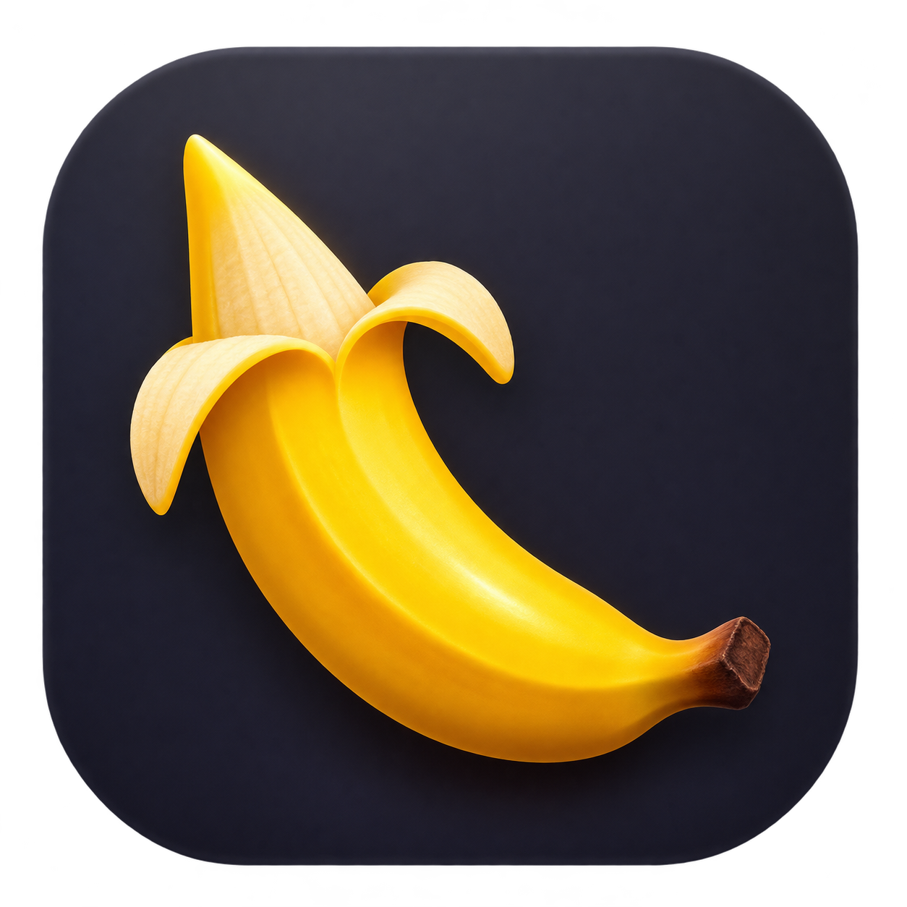
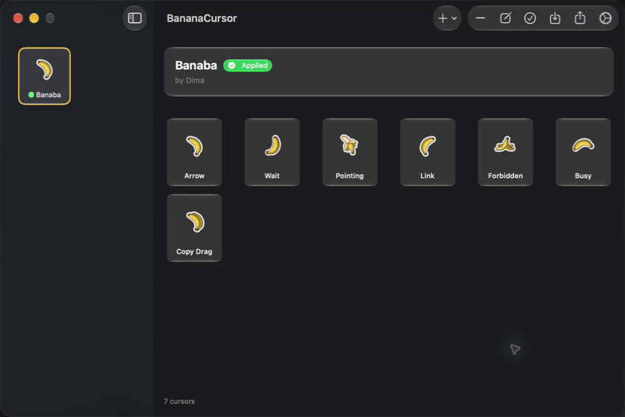

<p align="center">
  
</p>

<h1 align="center">BananaCursor</h1>

A macOS cursor manager. Import, preview, edit, and apply Mousecape `.cape` themes.

Requires macOS 15 or later. Builds for Apple silicon and Intel Macs.



## Use

**[Download BananaCursor.dmg](https://github.com/dmmeteo/BananaCursor/releases/latest/download/BananaCursor.dmg)**

Open the disk image, drag **BananaCursor** to **Applications**, then eject the image.

The app is ad-hoc signed and is not notarized by Apple. If macOS blocks the first launch, open **System Settings > Privacy & Security > Open Anyway** after trying to open the app. See [Apple's instructions](https://support.apple.com/en-us/102445).

1. Open BananaCursor.
2. Click **Import Cape** and choose a `.cape` file.
3. Select the theme and click **Apply Cape**. Use **Cape > Reset to Default** to restore system cursors.

Settings includes an optional helper that reapplies your theme after login and display changes. Enable only one cursor manager's helper at a time.

In **Settings > Updates**, use **Check for Updates** and **Install and Restart**. Automatic checks are on by default and run quietly at launch and once a day while the app is open. They check availability; downloads start only when you choose to install. You can turn automatic checks off and still check manually.

Version 0.1.0 needs a one-time manual upgrade from the disk image to get in-app updates.

BananaCursor stores themes in `~/Library/Application Support/BananaCursor/capes` and uses its own preferences. Import existing Mousecape themes explicitly. The original Mousecape library remains separate.

## Build

Install Xcode with the macOS 26 SDK or later, then run:

```sh
./scripts/build.sh
```

The app is at `build/DerivedData/Build/Products/Release/BananaCursor.app`. Build output is in `build/DerivedData/build.log`. The script downloads a pinned Sparkle SDK, builds both architectures, and applies a local ad-hoc signature. It does not produce a notarized app.

Run `./scripts/test.sh` for save and update lifecycle regressions. See [Releasing](docs/RELEASING.md) for DMG and signed update packaging.

To build in Xcode, open `Mousecape/Mousecape.xcodeproj` and select the **BananaCursor** scheme. Internal target and source-directory names retain their upstream names.

## Limits

Cursor changes use private macOS APIs and may need fixes after macOS updates. Windows `.cur` and `.ani` import is not included in this build.

## License

This is a noncommercial derivative of Mousecape and its SwiftUI redesign. The original [LICENSE](LICENSE) restricts commercial use. See [credits](CREDITS.md) for the source and authors.
